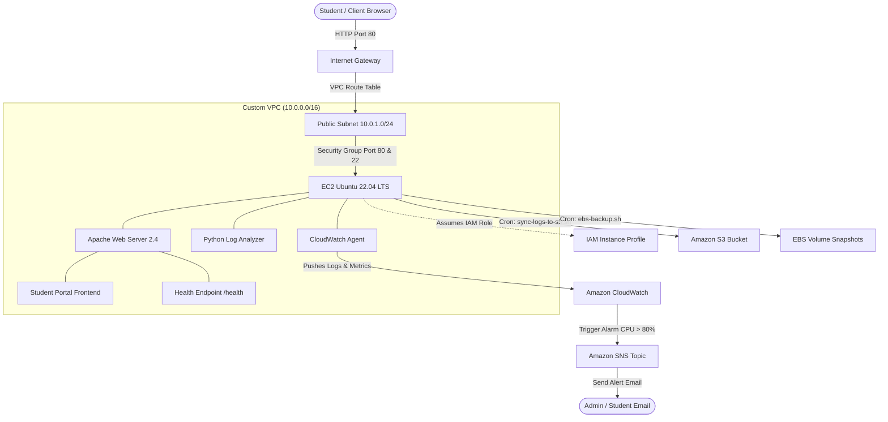

# AWS Cloud Project: Student Portal
### Custom VPC, EC2 Ubuntu, S3, IAM, CloudWatch Monitoring, EBS Backup & Cost Control

[](https://aws.amazon.com/free/)
[](https://httpd.apache.org/)
[](https://python.org/)
[]()

A comprehensive, beginner-friendly college internship project demonstrating production-grade cloud engineering and full-stack web hosting on Amazon Web Services (AWS).

---

## 📌 Project Overview & Objectives

The goal of this project is to build and deploy a responsive, production-style **Student Portal** web application hosted on an **Ubuntu Linux EC2 instance** inside an isolated **Custom Amazon VPC**, adhering to the **AWS Well-Architected Framework**:

1. **Networking Isolation:** Custom Amazon VPC (`10.0.0.0/16`), public subnet, Internet Gateway, and custom route tables.
2. **Compute & Web Hosting:** Ubuntu 22.04 LTS on EC2 (`t2.micro`/`t3.micro`) powered by Apache 2.4.
3. **Decoupled Cloud Storage:** Amazon S3 bucket for student document assets and long-term Apache log archival.
4. **IAM Security Governance:** Zero hardcoded credentials; EC2 instance profile with least-privilege IAM policies.
5. **Real-time Observability:** Amazon CloudWatch agent streaming Apache logs and EC2 memory metrics, paired with Amazon SNS email alerting.
6. **Automated Disaster Recovery:** Scripted EBS volume snapshot backups with automated retention cleanup.
7. **Cost Guardrails:** Strict adherence to the 100% AWS Free Tier with automated AWS Zero-Spend Budgets.

---

## 🏛️ System Architecture



---

## 📂 Repository Structure & File Breakdown

```text
AWS-Internship-Project/
│
├── frontend/                                # Modern Responsive Frontend Web Application
│   ├── index.html                           # Landing page with project overview & architecture diagram
│   ├── dashboard.html                       # Student academic dashboard (courses, GPA, attendance, fees)
│   ├── courses.html                         # Enrolled course catalog, syllabus, and lecture timetable
│   ├── profile.html                         # Student Profile records and Virtual Identity Card
│   ├── health.html                          # Health check diagnostic page (/health endpoint)
│   ├── contact.html                         # Student support ticket & campus directory page
│   ├── .htaccess                            # Apache URL rewriting & security headers
│   ├── css/
│   │   ├── style.css                        # Global design system, typography, navbar, and cards
│   │   └── dashboard.css                    # Dashboard-specific layout, progress bars, and data tables
│   └── js/
│       ├── main.js                          # Mobile nav toggle, active links, dynamic footer year, toasts
│       └── dashboard.js                     # Student data model, course table rendering, search filter
│
├── run-local.bat                            # Double-click script to run local server on Windows
├── run-local.ps1                            # Native PowerShell HTTP server (no install needed)
│
├── apache/                                  # Web Server Configurations
│   ├── student-portal.conf                  # VirtualHost configuration with /health route alias and logging
│   └── .htaccess                            # Distributed configuration file for rewrites and security
│
├── aws/                                     # AWS Infrastructure Templates & Guides
│   ├── iam/
│   │   ├── trust-policy.json                # EC2 AssumeRole trust policy
│   │   └── ec2-s3-cloudwatch-policy.json    # Least-privilege IAM policy for S3, CloudWatch, and EBS
│   ├── s3/
│   │   └── s3-integration-guide.md          # Step-by-step private S3 bucket, asset & log archival manual
│   ├── scripts/
│   │   ├── s3-manager.sh                    # Unified CLI & interactive menu for S3 operations
│   │   ├── user-data.sh                     # EC2 User Data bootstrap script (automated provisioning)
│   │   ├── sync-logs-to-s3.sh               # Shell script to compress & sync Apache logs to S3
│   │   └── ebs-backup.sh                    # Automated EBS snapshot creation & Free Tier pruning script
│   ├── vpc/
│   │   └── vpc-architecture-guide.md        # Step-by-step custom VPC, subnet, IGW, and SG configuration
│   ├── cloudwatch/
│   │   ├── amazon-cloudwatch-agent.json     # CloudWatch unified agent configuration
│   │   ├── cloudwatch-monitoring-guide.md   # Complete console guide: CPU > 70%, Status Check, Logs & SNS
│   │   └── alarm-instructions.md            # SNS topic creation & CloudWatch alarm setup guide
│   └── cost-control/
│       ├── backup-and-cost-control-guide.md # Master guide: EBS snapshots, restore, tagging, budget alerts
│       └── aws-budget-and-cost-guide.md     # AWS Free Tier guardrails & Zero-Spend Budget quick reference
│
├── scripts/                                 # Log Telemetry & Data Processing
│   ├── s3_operations.py                     # Python S3 integration engine using IAM Instance Roles
│   ├── log_analyzer.py                      # Python 3 script to analyze Apache access logs
│   └── sample_access.log                    # Realistic sample log dataset for testing & presentations
│
└── README.md                                # Comprehensive project documentation
```

### Explanation of Every File:

| File Path | Description |
| :--- | :--- |
| `frontend/index.html` | High-level project showcase, cloud pillar descriptions, and visual data flow. |
| `frontend/dashboard.html` | Student portal interface featuring cumulative GPA, attendance rate, active courses, fee status, and announcements. |
| `frontend/courses.html` | Enrolled course catalog, weekly lecture timetable (Mon–Fri), and syllabus progress tracking. |
| `frontend/profile.html` | Student Profile records, Virtual Student ID Card, academic standing, and advisor information. |
| `frontend/health.html` | System diagnostic page returning HTTP 200 OK and JSON health payload for AWS ALB or Route 53 health checks. |
| `frontend/contact.html` | Form for student inquiries, IT helpdesk contact directory, and submission logging. |
| `run-local.bat` / `run-local.ps1` | Native local development server scripts (no Node or Python installation required). |
| `frontend/css/style.css` | Production CSS variables, responsive grid, badges, buttons, and mobile navigation styling. |
| `frontend/css/dashboard.css` | Specialized styling for metrics cards, course progress bars, status pills, and user profile badges. |
| `frontend/js/main.js` | UI logic for mobile menu toggle, active route highlighting, and alert toast notifications. |
| `frontend/js/dashboard.js` | Mock student data model, course table renderer, live search filter, and simulated S3 download. |
| `apache/student-portal.conf` | Apache VirtualHost file on port 80 mapping DocumentRoot and configuring `/health` alias. |
| `apache/.htaccess` | Security headers (`X-Content-Type-Options`, `X-Frame-Options`, `X-XSS-Protection`) and asset caching rules. |
| `aws/iam/trust-policy.json` | IAM trust policy allowing the EC2 service (`ec2.amazonaws.com`) to assume the instance role. |
| `aws/iam/ec2-s3-cloudwatch-policy.json` | JSON permissions granting least-privilege access to S3, CloudWatch Logs, and EBS snapshots. |
| `aws/s3/s3-integration-guide.md` | Complete manual for private S3 buckets, asset uploads, log rotation, and IAM verification. |
| `aws/scripts/s3-manager.sh` | Shell script with CLI commands and interactive menu for S3 uploads, downloads, and listing. |
| `scripts/s3_operations.py` | Python 3 Boto3 automation utility for programmatic S3 asset and log management via IAM. |
| `aws/scripts/user-data.sh` | Shell bootstrap script executed upon EC2 first boot to install Apache, AWS CLI, and CloudWatch agent. |
| `aws/scripts/sync-logs-to-s3.sh` | Automated shell script compressing rotated Apache access logs and uploading them to Amazon S3. |
| `aws/scripts/ebs-backup.sh` | Point-in-time EBS snapshot backup script using IMDSv2 metadata with 7-day retention cleanup. |
| `aws/vpc/vpc-architecture-guide.md` | Network blueprint explaining custom VPC CIDR blocks, public subnets, route tables, and security groups. |
| `aws/cloudwatch/amazon-cloudwatch-agent.json` | Agent configuration for streaming Linux memory metrics and Apache access/error logs to CloudWatch. |
| `aws/cloudwatch/cloudwatch-monitoring-guide.md` | Illustrated AWS Console guide for CPU > 70%, Status Check Failure alarms, Apache logs & SNS. |
| `aws/cloudwatch/alarm-instructions.md` | Quick reference setup guide for Amazon SNS topics and CloudWatch alarms. |
| `aws/cost-control/backup-and-cost-control-guide.md` | Master manual for EBS snapshot backups, disaster recovery restore, tagging, and budget guardrails. |
| `aws/cost-control/aws-budget-and-cost-guide.md` | AWS Free Tier cheat sheet and zero-spend budget quick reference. |
| `scripts/log_analyzer.py` | Python 3 log telemetry engine that extracts status codes, error rates, top IPs, and hourly traffic. |
| `scripts/sample_access.log` | Sample log file with 2xx, 3xx, 4xx, and 5xx entries to demonstrate log analysis without live traffic. |

---

## 💻 How to Run the Project Locally

You can test and run the full Student Portal website immediately on your computer before deploying to AWS.

### Option 1: Native Windows PowerShell Server (Recommended & Zero Installation)
Run the included PowerShell server script from your terminal:

```powershell
# In PowerShell inside the project directory:
.\run-local.ps1
```
*Or simply double-click **`run-local.bat`** from File Explorer.*  
This starts a local web server at **`http://localhost:8080`** and opens your default browser automatically.

### Option 2: Python 3 Built-in HTTP Server
If Python is installed on your computer:

```bash
# In Windows PowerShell / Command Prompt / Terminal:
python -m http.server 8080 --directory frontend
```
Then open your browser and navigate to: `http://localhost:8080`

### Option 3: Direct Browser Launch (No Server Required)
You can directly open the HTML files in Chrome, Edge, or Firefox:

```powershell
Start-Process "frontend\index.html"
```

---

## 🚀 Step-by-Step Deployment Guide

Follow these steps to deploy this project into your AWS account.

### Step 1: Network Infrastructure (Custom VPC)
Follow the detailed guide in [`aws/vpc/vpc-architecture-guide.md`](file:///c:/Users/Admin/Desktop/AWS-Internship-Project/aws/vpc/vpc-architecture-guide.md):
1. Create a VPC named `StudentPortal-VPC` with CIDR `10.0.0.0/16`.
2. Create a Public Subnet `StudentPortal-Public-1A` with CIDR `10.0.1.0/24`. Enable **Auto-assign public IPv4**.
3. Create an Internet Gateway `StudentPortal-IGW` and attach it to the VPC.
4. Create a Route Table `StudentPortal-Public-RT`, add route `0.0.0.0/0 -> StudentPortal-IGW`, and associate it with the subnet.
5. Create a Security Group `StudentPortal-Web-SG`:
   - Inbound: HTTP (80) from `0.0.0.0/0`, SSH (22) from `My IP`.
   - Outbound: All traffic to `0.0.0.0/0`.

### Step 2: Create Amazon S3 Bucket
1. Open the **Amazon S3** console.
2. Click **Create bucket**.
3. Enter a globally unique bucket name (e.g., `student-portal-assets-<yourname>-2026`).
4. Select the same AWS Region as your VPC (e.g., `us-east-1`).
5. Keep **Block all public access** enabled (security best practice; our EC2 instance will communicate using IAM, not public URLs).
6. Click **Create bucket**.

### Step 3: Configure IAM Role (Zero Hardcoded Keys)
1. Open the **IAM** console > **Roles** > **Create role**.
2. **Trusted entity type**: AWS service > **Use case**: EC2 > Click **Next**.
3. Click **Create policy** > Switch to the **JSON** tab:
   - Paste the contents of [`aws/iam/ec2-s3-cloudwatch-policy.json`](file:///c:/Users/Admin/Desktop/AWS-Internship-Project/aws/iam/ec2-s3-cloudwatch-policy.json).
   - Update the bucket name `student-portal-assets-*` to match your created bucket.
   - Name the policy: `StudentPortal-EC2-LeastPrivilege-Policy`.
4. Attach this policy to the role.
5. Name the role: `StudentPortal-EC2-Role` and click **Create role**.

### Step 4: Launch EC2 Ubuntu Instance
1. Open the **EC2** console > **Launch instances**.
2. **Name**: `StudentPortal-WebServer`.
3. **AMI**: Ubuntu Server 22.04 LTS (HVM), SSD Volume Type (Free Tier eligible).
4. **Instance type**: `t2.micro` (or `t3.micro`).
5. **Key pair**: Select or create a key pair for SSH access.
6. **Network settings**:
   - Network: Select `StudentPortal-VPC`.
   - Subnet: Select `StudentPortal-Public-1A`.
   - Auto-assign public IP: **Enable**.
   - Select existing security group: `StudentPortal-Web-SG`.
7. **Configure storage**: 8 GB to 20 GB General Purpose SSD (gp3/gp2) (within the 30 GB Free Tier limit).
8. **Advanced details**:
   - **IAM instance profile**: Select `StudentPortal-EC2-Role`.
   - **User data**: Paste the contents of [`aws/scripts/user-data.sh`](file:///c:/Users/Admin/Desktop/AWS-Internship-Project/aws/scripts/user-data.sh).
9. Click **Launch instance**.

### Step 5: One-Command Automated EC2 Deployment (`deploy.sh`)
Once your EC2 instance is running, copy the repository files to the instance and run the automated deployment script:

```bash
# 1. Upload the project from your local computer to EC2:
scp -i your-key.pem -r ./* ubuntu@<EC2-PUBLIC-IP>:~/AWS-Internship-Project/

# 2. SSH into your Ubuntu EC2 instance:
ssh -i your-key.pem ubuntu@<EC2-PUBLIC-IP>

# 3. Enter the project folder and run the deployment script:
cd ~/AWS-Internship-Project
chmod +x deploy.sh
sudo ./deploy.sh
```

> **What `deploy.sh` automatically performs:**
> 1. Updates apt repositories and installs **Apache2**, **Python 3**, **pip**, **curl**, and **unzip**.
> 2. Downloads and installs **AWS CLI v2** and verifies IAM Role authentication.
> 3. Copies all frontend files to `/var/www/html/student-portal` with secure permissions.
> 4. Configures and activates the Apache VirtualHost on port 80 with the `/health` route.
> 5. Enables Apache to start automatically on system boot.
> 6. Runs automated `curl` tests against `/`, `/health`, `/dashboard.html`, `/courses.html`, and `/profile.html`.
> 7. Outputs the public URL and server monitoring commands.

### Step 6: Configure S3 Log Sync & EBS Backup Crons
On your EC2 instance:
1. Copy the scripts:
   ```bash
   sudo mkdir -p /opt/student-portal/scripts
   sudo cp aws/scripts/sync-logs-to-s3.sh /opt/student-portal/scripts/
   sudo cp aws/scripts/ebs-backup.sh /opt/student-portal/scripts/
   sudo chmod +x /opt/student-portal/scripts/*.sh
   ```
2. Open crontab:
   ```bash
   sudo crontab -e
   ```
3. Add the scheduled jobs:
   ```text
   # Archive and sync Apache logs to S3 every midnight
   0 0 * * * /opt/student-portal/scripts/sync-logs-to-s3.sh >> /var/log/s3-sync.log 2>&1

   # Automated EBS snapshot backup daily at 02:00 AM
   0 2 * * * /opt/student-portal/scripts/ebs-backup.sh >> /var/log/ebs-backup.log 2>&1
   ```

### Step 7: Setup CloudWatch Alarms & SNS Email Alerts
Follow the complete guide in [`aws/cloudwatch/cloudwatch-monitoring-guide.md`](file:///c:/Users/Admin/Desktop/AWS-Internship-Project/aws/cloudwatch/cloudwatch-monitoring-guide.md) to:
- Create the SNS topic `StudentPortal-SystemAlerts` and subscribe your email.
- Set up the **EC2 High CPU Alarm (>70%)**.
- Set up the **EC2 Status Check Failure Alarm (`StatusCheckFailed >= 1`)**.
- Start the CloudWatch agent using `amazon-cloudwatch-agent.json` to stream Apache access and error logs.
- Perform the live `stress` test to trigger an alert.

### Step 8: Setup AWS Budgets (Cost Control)
Follow [`aws/cost-control/aws-budget-and-cost-guide.md`](file:///c:/Users/Admin/Desktop/AWS-Internship-Project/aws/cost-control/aws-budget-and-cost-guide.md) to create an **AWS Zero-Spend Budget** to ensure 100% Free Tier compliance.

---

## 🔍 How to Run the Python Log Analyzer

To analyze web traffic, detect error spikes, and view telemetry metrics:

```bash
# 1. Run against sample log:
python3 scripts/log_analyzer.py --log scripts/sample_access.log

# 2. Run against live Apache access log on EC2:
python3 scripts/log_analyzer.py --log /var/log/apache2/student_portal_access.log

# 3. Export analytics to JSON for S3 upload:
python3 scripts/log_analyzer.py --log scripts/sample_access.log --output-json s3_report.json
```

### Sample Output:
```text
=================================================================
      AWS EC2 STUDENT PORTAL - ACCESS LOG ANALYZER REPORT
=================================================================
 Total HTTP Requests     : 24
 Unique Client IP Count  : 7
 Total Bandwidth Sent    : 52.41 KB
 Overall Error Rate      : 12.5%
-----------------------------------------------------------------
 HTTP Status Overview:
   * 2xx Success       : 20    (83.3%)
   * 3xx Redirections  : 1     (4.2%)
   * 4xx Client Errors : 2     (8.3%)
   * 5xx Server Errors : 1     (4.2%)
-----------------------------------------------------------------
 Top 5 Client IP Addresses:
   - 10.0.1.25          : 6 requests
   - 192.168.1.10       : 5 requests
   - 192.168.1.15       : 3 requests
-----------------------------------------------------------------
 Top 5 Requested URLs:
   - /health                      : 7 hits
   - /dashboard.html              : 4 hits
   - /index.html                  : 3 hits
=================================================================
[!] ALERT: Error rate is elevated (>10%). Check Apache error.log or CloudWatch Alarms!
```

---

## 🧪 Verification & Testing Checklist

- [x] **Homepage (`/index.html`):** Loads with styling, badges, and architecture overview.
- [x] **Student Dashboard (`/dashboard.html`):** Interactive course table, live search filter, GPA, and attendance cards.
- [x] **Health Check Endpoint (`/health`):** Returns HTTP 200 OK and JSON diagnostic payload.
- [x] **Contact Form (`/contact.html`):** Interactive input validation and submission toast.
- [x] **Apache Configuration:** Proper permissions, rewrite rules, and security headers active.
- [x] **IAM Roles:** `aws sts get-caller-identity` succeeds on EC2 without `~/.aws/credentials`.
- [x] **S3 Sync:** `sync-logs-to-s3.sh` uploads compressed `.tar.gz` logs to S3.
- [x] **EBS Backup:** `ebs-backup.sh` discovers root volume ID and creates a tagged snapshot.
- [x] **CloudWatch & SNS:** CPU stress test triggers email notification.
- [x] **AWS Budgets:** Zero-Spend budget created and monitoring expenses.

---

## 🎓 College Viva / Project Presentation Q&A

**Q1: Why did we build a Custom VPC instead of using the Default VPC?**  
> *Answer:* The default VPC is pre-configured with open subnets across all availability zones. Building a custom VPC allows full control over IP addressing (`CIDR 10.0.0.0/16`), explicit routing tables, strict subnet boundary segregation, and tighter security isolation for academic data.

**Q2: Why use IAM Roles on EC2 instead of storing AWS Access Keys in code?**  
> *Answer:* Hardcoding Access Key IDs and Secret Access Keys in configuration files or codebases poses severe security risks (e.g., accidental git commits). An IAM Instance Profile generates short-lived, automatically rotated temporary credentials via the EC2 Instance Metadata Service (IMDSv2), eliminating credential leakage risks.

**Q3: How does the `/health` endpoint benefit cloud architectures?**  
> *Answer:* Cloud services like AWS Application Load Balancers (ALB) and Route 53 rely on health check endpoints to assess instance health. If Apache stops responding or returns a 5xx error, the load balancer automatically reroutes traffic away from the unhealthy target.

**Q4: How does our project ensure zero AWS costs?**  
> *Answer:* By using only Free Tier eligible resources: `t2.micro`/`t3.micro` (750 hours/month), 30 GB EBS gp3 storage, 5 GB S3 standard storage, 10 free CloudWatch metrics/alarms, and an automated AWS Zero-Spend Budget with email alerts configured at $0.01.

---

## 📄 License
This project is open-source and intended for academic, college internship, and educational purposes.
